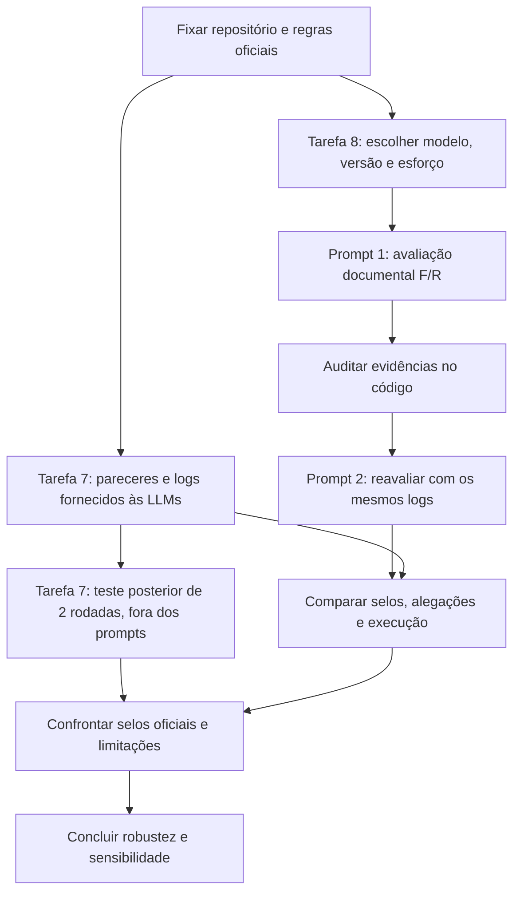

# Tarefa 8 — Registro experimental e matriz comparativa

**Data do primeiro experimento:** 15 de novembro de 2026  
**Disciplina:** Laboratório de Artefatos de Software  
**Artefato:** Selection Agent (K-Agent)  
**Repositório:** https://github.com/rafaeloj/sbrc2026  
**Diretrizes:** https://doc-artefatos.github.io/sbrc2026/revinstrucoes.html  
**Escopo:** selos F (Funcional) e R (Reprodutível).

## Protocolo de controle

- Reutilizar o mesmo artefato, a mesma edição das instruções oficiais e as evidências práticas documentadas na Tarefa 7.
- Fazer duas etapas por configuração: parecer analítico documental e reavaliação após logs.
- Abrir nova conversa para a análise; enviar a reavaliação na mesma conversa.
- Registrar provedor, identificação exata do modelo, nível de esforço selecionado, data, prompts, pareceres, citações e limites de acesso aos arquivos.
- Distinguir parecer **parcial/condicional** de um selo oficialmente concedido: “parcial” é classificação analítica do experimento, não um selo formal do evento.
- Não exigir 50 rodadas. A quantidade aparece no comando histórico da Tarefa 7, mas não deve ser usada como critério de aprovação.
- Não atribuir a uma variável experimental diferenças produzidas simultaneamente por mudanças no prompt, conjunto de evidências, revisão do artefato ou disponibilidade do mecanismo de busca.
- **Controle de amostra:** os seis pareceres da Tarefa 8 receberam apenas os trechos históricos Random/SUCCESS e falha de conexão Ollama. Uma execução **posterior** da Tarefa 7, com duas rodadas e inferência bem-sucedida, foi localizada no repositório acadêmico e é usada aqui somente como **triangulação complementar**; não foi apresentada às LLMs da Tarefa 8.

## Experimento 01 — OpenAI / ChatGPT

| Campo | Registro |
|---|---|
| Modelo informado pelo aluno | GPT-6 |
| Esforço informado pelo aluno | High |
| Interface | ChatGPT web |
| Data | 15/11/2026 |
| Identificador técnico do modelo | Não informado pela interface |
| Contexto | Nova conversa para avaliação analítica, reavaliação na mesma conversa (procedimento informado) |
| Artefato executado novamente na Tarefa 8? | Não; foram fornecidos resultados da Tarefa 7 |

### Etapa A — Parecer documental (resultado recebido)

- **F:** favorável à atribuição, mas pendente de comprovação por execução. F ainda não concedido em termos definitivos.
- **R:** favorável com ressalvas, pendente de reprodução dos resultados principais. R ainda não concedido em termos definitivos.
- **Evidências alegadas:** componentes `server_app.py`, `client_app.py`, `k_agent.py`; dependências Flower 1.23.0 e PyTorch 2.7.1; README com instalação do Ollama e modelo `qwen3:0.6b`; teste mínimo `random`; diretórios de resultados, notebooks e scripts; redução de tráfego alegada de 44,4% a 59%.
- **Limitações observadas pela LLM:** teste mínimo não cobre o K-Agent; dependência de serviço Ollama; preocupações com configuração de GPU, consistência de parâmetros, variação de modelos e controle de aleatoriedade; ausência de execução independente.
- **Verificação manual:** estrutura do código, dependências e README conferidos no GitHub. O `pyproject.toml` reserva GPU (0,2 por cliente e 1 no backend); o script de automação define datasets MNIST/CIFAR10 e identifica `$1` como `CUDA_DEVICE_IDS`; o utilitário Ollama existe em `scripts/utils/k_start_ollama.sh`. Permanecem a falta de controle integral do ambiente histórico Ubuntu e a ausência de fixação demonstrada de todas as sementes.

### Etapa B — Parecer após evidências práticas da Tarefa 7 (resultado recebido)

- **F:** *parcial / não confirmado*. A seleção `random` concluiu com `[SUCCESS] Simulation finished`, mas o fluxo principal do K-Agent não foi executado até o fim.
- **R:** *parcial / não confirmado*. Não há resultados independentes suficientes para confirmar as principais alegações de redução de tráfego, acurácia e seleção dinâmica.
- **Erro:** `ConnectionRefusedError: [Errno 111] Connection refused` ao tentar comunicar com o Ollama (`qwen3:0.6b`). O erro comprova recusa de conexão naquela tentativa; **não** comprova defeito no algoritmo nem identifica isoladamente a causa da falha.
- **Conclusão da LLM:** não recomendar concessão definitiva de F ou R sob as evidências disponíveis; manutenção de análise parcial até executar a função central e confrontar os resultados.
- **Limitação experimental:** este parecer reanalisou logs históricos fornecidos pelo aluno; não realizou nova execução.

### Matriz de comparação preliminar — Tarefa 7 × Tarefa 8

| Modelo | Etapa | Tarefa 7 (registro do aluno) | Tarefa 8: GPT-6 High | Mudança interpretável |
|---|---|---|---|---|
| GPT-6 | F documental | Atribuído* | Favorável, mas pendente | Postura documental mais condicional; equivalência com a ressalva (*) a confirmar no parecer original |
| GPT-6 | R documental | Parcial | Favorável com ressalvas; pendente | Essencialmente compatível; não é concessão definitiva |
| GPT-6 | F após logs | Parcial | Parcial / não confirmado | Mesma categoria geral |
| GPT-6 | R após logs | Parcial | Parcial / não confirmado | Mesma categoria geral |

**Leitura metodológica:** o veredito pós-logs do GPT-6 High não apresenta mudança categórica frente à linha de base informada para GPT-6 na Tarefa 7. O parecer atual distingue melhor sucesso parcial, dependência externa e impossibilidade de atribuir causa ao algoritmo; essa é uma observação qualitativa, não prova de superioridade do esforço High.

### Prompts documentados

**Prompt 1 — enviado nas avaliações analíticas da Tarefa 8:**

> Atue como um avaliador do comitê de artefatos do evento SBRC 2026. Com base exclusivamente nas instruções oficiais de avaliação de artefatos do SBRC 2026 e na documentação disponível no repositório (https://github.com/rafaeloj/sbrc2026), faça uma avaliação analítica do artefato "Selection Agent (K-Agent)".
>
> Indique se os selos F (Funcional) e R (Reprodutível) devem ser atribuídos. Para cada selo, exija o veredito final, as evidências encontradas na documentação que sustentam a sua decisão e aponte quaisquer falhas ou lacunas identificadas.

**Prompt 2 — variante adaptada utilizada nas reavaliações da Tarefa 8:**

> Agora, reavalie os selos F (Funcional) e R (Reprodutível) do artefato Selection Agent (K-Agent), considerando os resultados da execução prática realizada na Tarefa 7.
>
> Mantenha os mesmos critérios oficiais de avaliação do SBRC 2026 utilizados no seu parecer analítico anterior.
>
> **Ambiente de execução:**
> - Sistema operacional: Ubuntu 22.04 LTS
> - Python: 3.10
> - PyTorch: 2.7.1
> - CPU: 8 vCPUs
> - Memória RAM: 16 GB
>
> **Teste 1 — Seleção aleatória (random)**
>
> Comando: `flwr run . local-simulation --options selection-method='random' num-server-rounds=1`
>
> Resultado: `[SUCCESS] Simulation finished`
>
> O teste foi concluído com sucesso.
>
> **Teste 2 — Seleção K-Agent**
>
> Resultado:
> - O artefato tentou estabelecer conexão com o serviço Ollama.
> - Modelo utilizado: `qwen3:0.6b`.
> - Foi registrado o erro `ConnectionRefusedError: [Errno 111] Connection refused`.
> - A execução do K-Agent foi interrompida.
>
> A quantidade de rodadas não deve ser considerada um requisito obrigatório para a atribuição dos selos.
>
> **Solicitação:**
>
> Com base nessas evidências:
> 1. Confirme ou revise seu parecer anterior sobre o selo F.
> 2. Confirme ou revise seu parecer anterior sobre o selo R.
> 3. Apresente as evidências que justificam cada decisão.
> 4. Diferencie limitações do ambiente de execução de defeitos comprovados no artefato.
> 5. Indique quais funcionalidades foram demonstradas e quais não puderam ser verificadas.
> 6. Apresente um veredito consolidado sobre os dois selos, considerando os critérios oficiais do SBRC 2026.
>
> Não presuma que a falha de conexão com o Ollama comprova um defeito no algoritmo. Fundamente suas conclusões exclusivamente nas evidências disponíveis.

> **Atenção:** os **dois prompts** da Tarefa 8 diferem textualmente dos dois originais da Tarefa 7, embora preservem objetivo e escopo. Na Tarefa 7, o Prompt 1 citava expressamente a faixa de redução de tráfego 44,4%–59% e pedia uma das categorias “Atribuído/Não Atribuído/Parcial”; a Tarefa 8 omitiu essas palavras. O Prompt 2 também foi adaptado e incluiu a ordem de não presumir defeito algorítmico. Os prompts são **idênticos entre as três novas configurações**, mas a comparação intertarefas não isola causalmente versão/esforço. Transcrições históricas disponíveis em `evidencias/GPT6_TRANSCRICAO_ORIGINAL_2026-11-06.md`, `CLAUDE_TRANSCRICAO_2026-11-05.md` e `GEMINI_AVALIACAO_ORIGINAL_2026-11-05.md` no [repositório da Tarefa 7](https://github.com/fernandomarquesaluno-svg/ativ_revisao_artfatos_multiplas_llms).

## Visão geral das avaliações da Tarefa 8

| Provedor | Configuração | Analítica | Após logs | Situação |
|---|---|---|---|---|
| OpenAI | GPT-6 High | F favorável/pendente; R favorável com ressalvas/pendente | F parcial; R parcial | Concluído (pareceres coletados) |
| Google | Gemini 4 Hydrogen, modo Thinking (nível numérico não informado), Gemini Web | F não atribuído; R não atribuído | F não atribuído; R não atribuído | Concluído; nível exato de esforço pendente |
| Anthropic | Claude Sonnet 5.0, esforço Extra, Claude Desktop (Windows) | F favorável/condicional; R favorável/condicional | F atribuir; R não atribuir | Concluído (pareceres coletados) |

**Declaração do avaliador sobre as configurações:** em 15/11/2026, o aluno informou ter utilizado **GPT-6 com esforço High** no ChatGPT, **Gemini 4 Hydrogen no modo Thinking** pela interface web e **Claude Sonnet 5.0 com esforço Extra** no aplicativo de PC. O aluno autorizou expressamente o uso desse relato como **declaração de configuração**, dispensando por ora capturas de tela. Os nomes e níveis acima são **autodeclarados**, sem comprovação independente por imagem ou identificador técnico de API. Para o Gemini, não foi declarado um nível adicional de esforço além da seleção “4 Hydrogen Thinking”.

### Configuração do Experimento 03 — Anthropic

- Modelo: **Claude Sonnet 5.0** (identificação apresentada pelo aluno; sem ID técnico de API).
- Esforço de raciocínio: **Extra** (opção apresentada no aplicativo).
- Interface: **aplicativo para PC**, não interface web do navegador.
- Data: **15/11/2026**.
- Referência histórica: **Claude 3.5 Sonnet** na Tarefa 7, cujo esforço não foi confirmado.
- Variações simultâneas: versão e esforço; o desenho atual permite analisar o efeito conjunto, mas não isolar causalmente cada variável.
- Avaliação documental e reavaliação após logs: **ambas recebidas**.

## Experimento 02 — Google Gemini: parecer analítico e auditoria

**Configuração:** Gemini Web; modelo **Gemini 4 Hydrogen**, opção exibida **“4 Hydrogen Thinking”** (confirmada pelo aluno). O modo Thinking é conhecido, mas o eventual nível numérico de esforço (por exemplo, Low/Medium/High) **não foi informado**. Parecer de avaliação documental recebido em 15/11/2026. Referência de nomenclatura: [cartão oficial do Gemini 4 Hydrogen](https://deepmind.google/models/model-cards/gemini-4-hydrogen/).

**Vereditos emitidos pela LLM:** F **não atribuído**; R **não atribuído**. Esses são *vereditos da LLM*, não deliberações oficiais do SBRC 2026.

**Evidências e auditoria independente do repositório `rafaeloj/sbrc2026`, branch `main`:**

| Alegação do Gemini | Verificação | Impacto |
|---|---|---|
| `utils/k_start_ollama.sh` inexistente e automação quebrada por ausência do arquivo | **Falsa como formulada**: existe em `scripts/utils/k_start_ollama.sh`, e `scripts/k_agent_prompt_type.sh` o invoca por `"$SCRIPT_DIR/utils/k_start_ollama.sh"`. O README usa caminho relativo abreviado, potencialmente ambíguo. | Não usar a suposta ausência como evidência para negar F/R. |
| Argumento posicional `0` não explicado e tempo do lote não indicado | **Parcialmente imprecisa**: o script exibe `Usage: $0 <CUDA_DEVICE_IDS>`, exporta `CUDA_VISIBLE_DEVICES=$1` e registra comentário `# Tempo de Execução: ~240h`. No README, o significado do argumento não é explicado em detalhe. | Lacuna de clareza documental, mas não informação inexistente no código. |
| Falta de seleção de dataset no roteiro de automação | **Parcialmente falsa**: o script define `DATASETS=("mnist" "cifar10")` e envia `dataset-name='$DS'` via `--run-config`; o `pyproject.toml` define `dataset-name = "mnist"` como padrão. A correspondência específica entre cada figura e dataset ainda merece verificação. | Não afirmar ausência universal de dataset ou de forma de configurá-lo. |
| Todas as dependências centrais sem versões | **Exagerada**: `pyproject.toml` fornece mínimos `>=` para bibliotecas LangChain/LangGraph, Transformers, PEFT, TRL etc.; Flower, torch e torchvision estão pinadas com `==`. Ollama não tem versão pinada identificada. | A falta de pinagem estrita de várias dependências é risco real, mas não falta completa de versões. |
| Teste mínimo usa `random` e não demonstra K-Agent | **Confirmada** no README. | Limitação válida da evidência documental de F. |
| Documentação informa JSON em `outputs/`, enquanto notebooks de tabelas consomem `results/` | **Confirmada como aparente inconsistência textual do README**; não se demonstrou ausência de todas as formas de transformação/migração. | Solicitar prova adicional de pipeline, sem declarar sua impossibilidade. |
| Configurações de hardware/GPU são inconsistentes ou pouco claras | **Preocupação plausível e relevante**: `pyproject.toml` reserva GPU e configura `init_args.num_gpus = 1`, embora o README a descreva como opcional; `scripts/utils/k_start_ollama.sh` fixa `--gpus='"device=0"'`. | Fragilidade operacional real a testar; não comprova por si só falha em toda execução. |
| Ausência de controle de sementes e impossibilidade definitiva de reprodução | **Não completamente verificada**: requer busca adicional em código, notebooks e materiais do artigo. | Evitar aceitar afirmação absoluta sem inspeção completa. |

**Fontes primárias consultadas:**
- https://github.com/rafaeloj/sbrc2026/blob/main/README.md
- https://github.com/rafaeloj/sbrc2026/blob/main/scripts/k_agent_prompt_type.sh
- https://github.com/rafaeloj/sbrc2026/blob/main/scripts/utils/k_start_ollama.sh
- https://github.com/rafaeloj/sbrc2026/blob/main/selection-agent/pyproject.toml

**Comparação dos pareceres documentais:** o Gemini apresentou uma decisão mais restritiva do que o GPT-6 High (que considerou F favorável/condicional e R favorável com ressalvas). Parte da divergência decorre de uma **evidência falsa**: a alegação de arquivo inexistente. Portanto, não se deve equiparar maior severidade a maior acurácia. O Prompt 2 da Tarefa 8 foi mantido igual nas três reavaliações.

### Etapa B — Reavaliação após logs históricos da Tarefa 7

O Gemini **manteve integralmente** suas classificações documentais: **F não atribuído** e **R não atribuído**. Reconheceu o sucesso do baseline `random`, a tentativa de conexão do K-Agent com o Ollama e a inexistência de execução completa da função central; não tratou a quantidade fixa de rodadas como requisito obrigatório.

**Persistência de erros de evidência:** o modelo **repetiu na etapa pós-logs** a alegação de que `utils/k_start_ollama.sh` está ausente. A afirmação é falsa se interpretada como inexistência do utilitário no repositório: ele está em `scripts/utils/k_start_ollama.sh`, caminho chamado pelo script de automação. O README usa um caminho abreviado/ambíguo, uma crítica documental possível, mas não prova de arquivo ausente. O parecer também manteve generalizações sobre ausência de parâmetros de datasets e do argumento de GPU, apesar da presença dessas informações no script.

**Limites da inferência sobre o erro:** `ConnectionRefusedError` evidencia recusa de conexão ao endpoint acionado na tentativa relatada. Não prova isoladamente que o serviço estava inativo na máquina, que o endereço/porta estavam corretos ou que o algoritmo tenha defeito. A alegação do Gemini de que o serviço Ollama estava necessariamente inativo é mais forte do que os logs permitem.

**Não atribuir como verificação independente:** o parecer afirma que o módulo K-Agent foi importado, que o identificador do modelo foi resolvido e que não há falhas lógicas; essas conclusões são parcialmente inferidas do estágio em que houve erro, sem logs completos que permitam auditar cada subetapa.

**Resumo final da comparação de decisões após logs:** Tarefa 7 GPT-6: F parcial / R parcial; Tarefa 8 GPT-6 High: F parcial / R parcial; Tarefa 8 Gemini 4 Hydrogen Thinking: F não atribuído / R não atribuído. Não confundir diferença de classificação com melhora factual. Nenhuma nova execução do K-Agent foi apresentada nesta etapa.

## Experimento 03 — Claude Sonnet 5.0 Extra

### Etapa A — Parecer documental

- **F:** recomendou atribuição **condicionada à execução efetiva**; citou a documentação, a existência do código do agente, `ChatOllama` e ferramentas com retentativas.
- **R:** recomendou atribuição **condicionada à reprodução das reivindicações #1 e #2**, alegando que a documentação vincula cada reivindicação a parâmetros, hardware, tempo e notebooks, e que o repositório tem resultados de referência.
- **Acertos confirmados na inspeção:** existem os componentes do agente; `k_agent.py` usa `ChatOllama`, `create_agent`, ferramentas e um laço que tenta novamente após exceções. Os parâmetros do Flower reservam GPU apesar de o README dizer que ela é opcional; o teste mínimo é `random`. A árvore do repositório tinha **294 arquivos terminados em `federation_data.json`** na verificação de 15/11/2026.
- **Ressalvas da auditoria:** ter dados anteriores não equivale a reproduzir experimentalmente novas métricas; `while fail` no agente não apresenta limite explícito de tentativas, logo a existência de retentativa não garante recuperação adequada. O README possui uma seção específica de segurança com vários cuidados, sendo impreciso descrevê-la como somente um aviso sobre a API Ollama.

### Etapa B — Reavaliação após os logs históricos

- **F:** o Claude **manteve e confirmou atribuir**, interpretando `[SUCCESS] Simulation finished` no teste mínimo `random` como suficiente para observar algumas funcionalidades; ressalvou que K-Agent não foi validado.
- **R:** o Claude **revisou para não atribuir neste ciclo**; nenhuma das duas reivindicações principais foi reproduzida no conjunto de logs apresentado. A reivindicação #2 (Oort/amostragem dinâmica) nem sequer foi tentada.
- **Análise correta:** `ConnectionRefusedError` não comprova defeito algorítmico; sem stack trace completo não se pode determinar onde ocorreu o erro ou se foi tratado. O número fixo de rodadas não foi usado como critério obrigatório.
- **Excesso de inferência:** o parecer afirmou que o sucesso de `random` comprova operação em ambiente **sem GPU**, mas a descrição enviada do equipamento cita 8 vCPUs/16 GB RAM, sem prova inequívoca de GPU ausente. Atribuir a causa exata ao serviço Ollama não iniciado é hipótese plausível, não causa demonstrada apenas por recusa de conexão.
- **Outros itens citados:** o arquivo `selection-agent/selection_agent/selections/deev_selection.py` existe. A enumeração de estratégias não representa prova de execução delas.

## Tabela comparativa consolidada — Tarefa 7 × Tarefa 8

| Provedor/modelo | Etapa | F na Tarefa 7 | R na Tarefa 7 | F na Tarefa 8 | R na Tarefa 8 |
|---|---|---|---|---|---|
| OpenAI, GPT-6 → GPT-6 High | Documental | Atribuído* | Parcial | Favorável, condicionado | Favorável com ressalvas, pendente |
| OpenAI, GPT-6 → GPT-6 High | Após logs | Parcial | Parcial | Parcial, não confirmado | Parcial, não confirmado |
| Google, Gemini 1.5 Pro → Gemini 4 Hydrogen Thinking | Documental | Atribuído | Atribuído | Não atribuído | Não atribuído |
| Google, Gemini 1.5 Pro → Gemini 4 Hydrogen Thinking | Após logs | Atribuído | Atribuído* | Não atribuído | Não atribuído |
| Anthropic, Claude 3.5 Sonnet → Sonnet 5.0 Extra | Documental | Parcial | Parcial | Favorável, condicionado | Favorável, condicionado |
| Anthropic, Claude 3.5 Sonnet → Sonnet 5.0 Extra | Após logs | Parcial | Parcial* | **Atribuir** | **Não atribuir** |

**Origem da linha de base:** matriz da Tarefa 7 inicialmente informada pelo aluno, **agora confrontada com as transcrições e o CSV originais** preservados no [repositório acadêmico](https://github.com/fernandomarquesaluno-svg/ativ_revisao_artfatos_multiplas_llms/blob/main/comparacao_llms.csv). Os asteriscos têm significado recuperado: GPT-6 F documental foi atribuído **com ressalvas**; Gemini R pós-logs foi mantido **com ressalva de execução**; Claude R pós-logs permaneceu **parcial, com risco de não atribuição**. As transcrições da Tarefa 7 não exibem inequivocamente as versões de Claude e Gemini; as denominações “Claude 3.5 Sonnet” e “Gemini 1.5 Pro” são registros declarados pelo aluno, não metadados verificados por screenshot. Os pareceres da Tarefa 7 não foram reexecutados neste relatório. Diferenças entre “parcial”, “condicional” e “não atribuído” também refletem escolhas verbais; não equivalem automaticamente a decisões oficiais binárias.

### Comparação com os selos oficiais

A página do próprio CTA do SBRC 2026 relaciona o artefato **Agente K-alibra**, vinculado a `rafaeloj/sbrc2026`, com os selos **F e R atribuídos**. Fonte: https://doc-artefatos.github.io/sbrc2026/results.html. As negativas e ressalvas das LLMs se referem **ao conjunto de evidências local da disciplina**, não revogam o resultado oficial nem demonstram que o artefato esteja defeituoso.

### Evidências reais e consistência entre modelos

| Evidência | Verificação humana | Consequência para a avaliação |
|---|---|---|
| Teste `random` terminou com `[SUCCESS] Simulation finished` | Transcrição dos logs históricos enviada pelo aluno; novos logs não produzidos neste estudo | Demonstra o caminho básico testado; não demonstra K-Agent |
| Teste K-Agent terminou com `ConnectionRefusedError` | Transcrição histórica enviada pelo aluno | Impediu observar seleção via LLM; causa exata da recusa não foi isolada |
| `scripts/utils/k_start_ollama.sh` não existe | **Falso**: arquivo presente e referenciado pelo script principal | Duas justificativas do Gemini foram enfraquecidas; uma alegação falsa persistiu após os logs |
| Dataset não configurável no script | **Falso**: o script define MNIST/CIFAR10 e passa `dataset-name` ao `--run-config` | Alegação do Gemini excessiva; mapeamento de figuras específicas ainda pode requerer documentação |
| GPU é opcional em todo caminho de execução | **Não demonstrado**: README diz opcional, mas Flower reserva GPU e script Docker fixa dispositivo | Risco real de portabilidade; não significa que o teste histórico falhou por GPU |
| Dados experimentais publicados | **Confirmado**: 294 JSONs `federation_data.json` na árvore inspecionada | Dá rastreabilidade e suporte à auditoria; não substitui execução independente do experimento |
| Condição `server_round > 1` da estratégia | **Confirmado no código** `selection_agent_strategy.py` no commit fixado | Um teste configurado com K-Agent em apenas uma rodada não chama a seleção pelo agente |
| K-Agent em duas rodadas no Codespaces da Tarefa 7 | **Auditoria histórica de pacote**: `POST /api/chat` HTTP 200, ferramenta `oort_selection` com `k=1`, treinamento concluído e saída zero; ver [auditoria do pacote](https://github.com/fernandomarquesaluno-svg/ativ_revisao_artfatos_multiplas_llms/blob/main/evidencias/AUDITORIA_KAGENT_2_RODADAS_2026-11-06.md) | Demonstra funcionalidade central em cenário reduzido **após** os relatos iniciais; **não foi fornecida às LLMs da Tarefa 8** e não confirma R |

**Proveniência da execução complementar:** pacote `evidencias_kagent_2rodadas_20261106T111254Z.tar.gz`, SHA-256 `d5667dd68c7c596f25d12e7810a3f43c336ab97dce0274857c62a4eeceee5e41`, descrito na auditoria da Tarefa 7. O resumo e o hash constam do repositório acadêmico; o pacote binário **não foi reaberto nesta auditoria da Tarefa 8**. Ambiente desse teste posterior: Codespaces/Ubuntu, 4 vCPUs, Python 3.10.12, Flower 1.23.0, sem GPU, cinco clientes e `qwen3:0.6b`. São condições diferentes das tentativas Ubuntu iniciais relatadas às LLMs. A saída de duas rodadas não valida quantitativamente a faixa científica de 44,4% a 59%.

**Referência exata de código:** `949f83c6db86d682240b7a61d1d2d406609413b6` (último commit da `main` do [artefato](https://github.com/rafaeloj/sbrc2026/commit/949f83c6db86d682240b7a61d1d2d406609413b6), conferido em 15/11/2026), coincidente com o commit capturado nos pacotes do Codespaces da Tarefa 7. O SHA da tentativa Ubuntu histórica original não está documentado e não pode ser presumido igual.

**Achados de robustez:** (1) GPT-6 High preservou os pareceres parciais após logs da linha de base informada; (2) Gemini foi significativamente mais severo e apresentou erro factual repetido; (3) Claude mudou sua recomendação sobre R após logs, mantendo F pela interpretação do teste mínimo; (4) as três LLMs reconheceram que a função central do K-Agent não foi comprovada nos logs enviados; (5) nenhuma nova configuração demonstrou que maior esforço necessariamente aumenta fidelidade factual.

## Fluxograma experimental atualizado

## Conclusão crítica

A Tarefa 8 **evidenciou sensibilidade à configuração e à formulação dos prompts** no julgamento documental e na interpretação do mesmo conjunto de logs, mas não permite estimar efeito causal isolado do nível de esforço. Em especial, as decisões pós-logs divergiram em F: Claude recomenda atribuição com base no teste mínimo, GPT-6 High mantém avaliação parcial e Gemini não atribui. A divergência envolve uma diferença interpretativa sobre o que basta para F e, no caso do Gemini, erros objetivos em evidências de estrutura do repositório. Em R, nenhum dos novos pareceres comprova a reprodução das duas reivindicações científicas no ambiente da disciplina; embora os rótulos difiram, não há recomendação incondicional de concessão.

**Maior profundidade verbal não é sinônimo de maior acurácia.** A auditabilidade das evidências — caminhos reais, comandos, configuração, outputs e logs completos — foi decisiva para detectar afirmações falsas e calibrar o alcance dos vereditos. **Um pacote posterior da Tarefa 7 documenta a funcionalidade K-Agent em duas rodadas**, mas não entrou nas entradas dadas às três LLMs da Tarefa 8; portanto, não é válido criticá-las por não considerá-lo. A execução limitada usada nos novos pareceres sinaliza uma lacuna de comprovação naquele *conjunto de dados*, não invalida o artefato ou os selos oficiais.

### Limitações experimentais e itens pendentes

1. **Gemini:** modelo e modo informados como Gemini 4 Hydrogen, seleção “4 Hydrogen Thinking”. Não presumir esforço numérico máximo a partir dessa expressão; confirmar apenas se havia um ajuste adicional e explícito de nível.
2. **Controle de versão:** auditoria do código e execução posterior do Codespaces convergem no SHA `949f83c6...`; a tentativa histórica Ubuntu que compôs o Prompt 2 **não tem SHA comprovado**, de modo que não se pode garantir que a mesma revisão foi executada nela.
3. **Esforço da linha de base:** o valor de esforço usado na Tarefa 7 não está documentado para todos os modelos. No Claude, houve alteração simultânea de versão e esforço.
4. **Prompts:** os Prompts 1 e 2 da Tarefa 8 são variações textuais dos históricos da Tarefa 7. Foram mantidos entre os três novos modelos, mas não são idênticos à linha de base; o Prompt 2 inclui instrução expressa para não presumir defeito algorítmico.
5. **Repetições:** há um parecer de cada configuração/etapa, sem amostras repetidas para estimar variância intra-modelo.
6. **Execução:** esta fase reutilizou os logs da Tarefa 7; não houve nova execução física do artefato na Tarefa 8. Para uma repetição prática integral, seria necessário testar novamente com Ollama acessível e confrontar as reivindicações com dados gerados na nova execução.
7. **Regras oficiais:** as avaliações usaram como referência a edição SBRC 2026. A [página de resultados oficiais](https://doc-artefatos.github.io/sbrc2026/results.html) foi conferida diretamente. O endereço da página específica de instruções não pôde ser aberto nesta auditoria atual, **mas seu texto integral está preservado no repositório da Tarefa 7**, com fonte e data de consulta 05/11/2026 em [INSTRUCOES_SBRC2026.txt](https://github.com/fernandomarquesaluno-svg/ativ_revisao_artfatos_multiplas_llms/blob/main/evidencias/INSTRUCOES_SBRC2026.txt); isso documenta o referencial efetivamente usado, sem alegar nova leitura direta do site.
8. **Documentação do estudo:** as configurações são registradas como **declaração do aluno**, sem capturas de interface por sua escolha explícita neste momento. Preservar os seis pareceres integrais e os prompts, além do resumo, para permitir auditoria externa. Prints são evidência complementar opcional, não condição adotada para finalizar este relatório.

**Status do trabalho:** seis pareceres reunidos; tabela, fluxograma, auditoria de código, confronto com transcrições históricas e conclusão consolidados; configurações registradas por declaração do aluno, sem exigência de capturas. Permanecem ressalvas metodológicas: ausência de nova execução física do artefato na Tarefa 8, prompts não idênticos entre tarefas, SHA da tentativa Ubuntu histórica desconhecido e nível adicional de esforço do Gemini não informado. A evidência posterior de duas rodadas valida funcionalidade central, mas não reprodução científica dos resultados.

## Pacote final de pareceres e dados de comparação

Os seis pareceres enviados pelo aluno foram organizados em **três registros por provedor**, cada um contendo a avaliação analítica e a reavaliação pós-logs, com vereditos, evidências, justificativas e limitações:

1. [OpenAI — GPT-6 High (dois pareceres)](pareceres/01_openai_gpt6_high.md).
2. [Google — Gemini 4 Hydrogen Thinking (dois pareceres)](pareceres/02_google_gemini_4_hydrogen_thinking.md).
3. [Anthropic — Claude Sonnet 5.0 Extra (dois pareceres)](pareceres/03_anthropic_claude_sonnet_5_extra.md).

O [índice de proveniência e auditoria factual](pareceres/README.md) distingue afirmações emitidas pelas LLMs de evidências conferidas diretamente no código. O [CSV comparativo T7 × T8](comparacao_t7_t8.csv) possibilita recalcular/filtrar a matriz de seis linhas por provedor e etapa. **Os arquivos dos pareceres são registros editoriais estruturados das respostas recebidas, não exportações brutas nem transcrições byte a byte das interfaces.** A configuração foi declarada pelo aluno; não há captura de tela nesta entrega.

### Checklist de encerramento metodológico

| Exigência da Tarefa 8 | Entrega / controle |
|---|---|
| Mesmo artefato e critérios | K-Agent/SBRC 2026, repositório e commit auditado documentados; sem pressupor que a tentativa Ubuntu antiga ocorreu no mesmo SHA. |
| Três provedores e variações | GPT-6 High, Gemini 4 Hydrogen Thinking e Sonnet 5.0 Extra; versão/nível conforme declaração, com lacunas explícitas. |
| Avaliação analítica e pós-execução | Seis pareceres arquivados; segundo parecer usa **resultados informados da Tarefa 7**, sem falsa alegação de execução nova. |
| Prompts | Prompts 1 e 2 registrados integralmente neste relatório e na página interativa; alterações frente à T7 declaradas. |
| Evidências verificadas | Helpers, argumentos, datasets e configuração checados no código; inconsistências das LLMs marcadas como refutadas ou inconclusivas. |
| Comparação T7 × T8 e selos oficiais | Matriz no relatório, CSV exportável e comparador no site; categorias descritivas separadas dos selos oficiais. |
| Fluxograma e conclusão | Fluxo de etapas, confronto de resultados e limites inferenciais incluídos. |
| Rodadas/repetições | Não existe obrigação de 50 rodadas como requisito da disciplina; ausência de repetições independentes foi declarada. |

**Condição de fechamento:** relatório e site prontos para apresentação **com ressalvas documentadas**. Não se pode afirmar que maior esforço, isoladamente, causou melhoria, nem que R foi reproduzido pela Tarefa 8. A execução posterior bem-sucedida do K-Agent na Tarefa 7 é evidência complementar, fora das entradas dos modelos nesta rodada.

## Materiais organizados para entrega

- **Página interativa da Tarefa 8**, integrada ao mesmo portfólio das atividades anteriores: https://fernandomarquesaluno-svg.github.io/portfolio-artefatos-software/atividade-8/
- **Repositório e relatório técnico versionados:** https://github.com/fernandomarquesaluno-svg/portfolio-artefatos-software/tree/main/atividade-8
- **Fonte primária dos pareceres e auditorias da Tarefa 7:** https://github.com/fernandomarquesaluno-svg/ativ_revisao_artfatos_multiplas_llms
- **Artefato SBRC 2026 sob o commit inspecionado:** https://github.com/rafaeloj/sbrc2026/tree/949f83c6db86d682240b7a61d1d2d406609413b6

**Validação da publicação:** página aberta em navegador; matriz alternável, filtro de evidências e ligação pela página inicial do portfólio testados em 15/11/2026. Esta validação é da **interface de apresentação**, não do funcionamento do K-Agent. O estudo está documentado e publicável com as limitações expressas, sem alegação de reprodução independente das reivindicações científicas nesta Tarefa 8.
